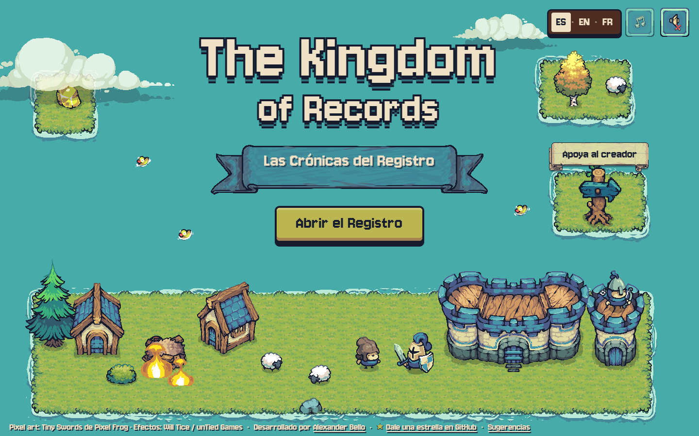
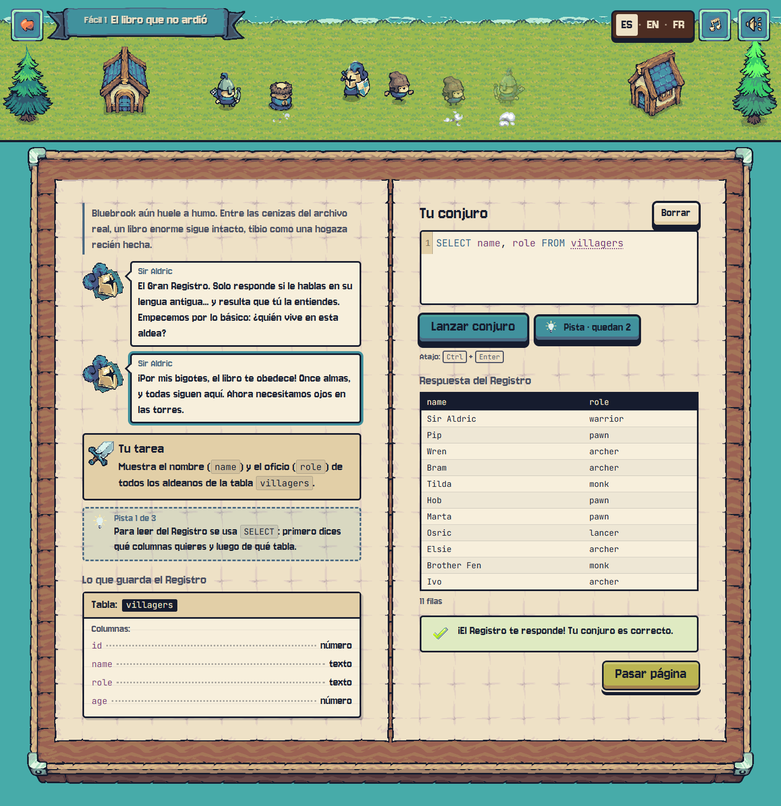
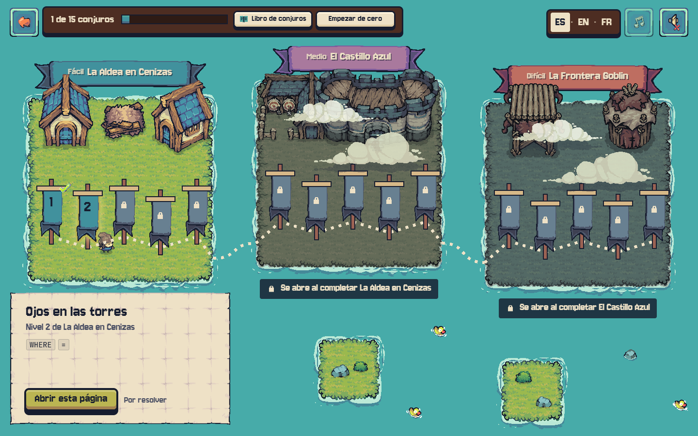
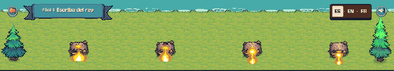
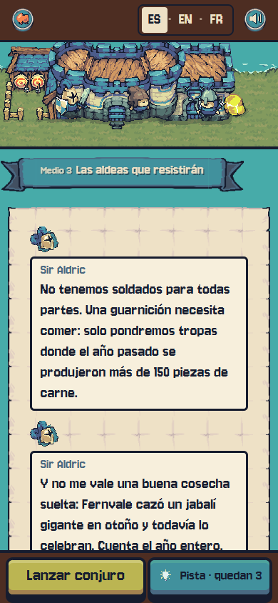

# The Kingdom of Records

*The Chronicles of the Registry* — a pixel-art web game to learn SQL.

Goblins have burned the royal archive of the Blue Kingdom. Only the **Great Registry** survived: a
magic book that answers questions asked in an ancient tongue, SQL. You play Pip, a young shepherd and
the new royal scribe, and every query you write recovers a piece of the truth, until the traitor
behind the raid is found.

- 15 levels in three stages, from `SELECT` to joins and subqueries.
- Real SQL: queries run in SQLite inside the browser. No account, no server.
- Spanish, English and French.
- Works on desktop and phone, with keyboard support.



| A level, solved | The kingdom map |
|---|---|
|  |  |

| The village reacts to a correct answer | On a phone |
|---|---|
|  |  |

## How to play

1. Press **Open the Registry** on the title screen (or **Keep reading** to go back to where you left off).
2. Read the story and the task on the left page. **What the Registry holds** lists the tables and
   columns you can use.
3. Write your SQL in the editor on the right and press **Cast spell** (or `Ctrl` + `Enter`,
   `Cmd` + `Enter` on Mac). Table and column names are suggested as you type.
4. The Registry shows the result. If it is not what was asked, it tells you what differs, and SQL
   errors are explained in plain words.
5. Stuck? Each level has three hints, from a gentle nudge to almost the answer.
6. When the answer is right, the scene above the book reacts and **Turn the page** takes you on.

| Stage | Levels | What you learn |
|---|---|---|
| Easy — *The Village in Ashes* | 1–5 | `SELECT`, `WHERE`, `AND` / `OR` / `IN`, `LIKE` and `ORDER BY`, `INSERT` and `UPDATE` |
| Medium — *The Blue Castle* | 1–5 | Aggregates, `GROUP BY`, `HAVING`, `DELETE` and `UPDATE` with conditions, a first `JOIN` |
| Hard — *The Goblin Frontier* | 1–5 | Several joins, `LEFT JOIN`, subqueries, subqueries with aggregates, and a final challenge |

Each stage unlocks when the previous one is finished. The database is rebuilt from scratch every
time you run a query, so you cannot break anything. Solved levels can be played again from a blank
page, and the map offers **Start over** to erase all progress.

The language selector (ES · EN · FR) and the music and sound buttons are always in the top bar. Progress is saved
in your browser.

## Run it locally

Requirements: [Node.js](https://nodejs.org) 20.19 or newer (developed with Node 26, see `.nvmrc`) and
npm.

```bash
npm install
npm run dev        # then open http://localhost:5173
```

| Script | What it does |
|---|---|
| `npm run dev` | Starts the development server. |
| `npm run build` | Type-checks and builds the static site into `dist/`. |
| `npm run preview` | Serves the production build at http://localhost:4173. |
| `npm test` | Runs the tests (Vitest), including a check that every level's own solution passes. |
| `npm run typecheck` | Type-checks without building. |

## Publish it

`dist/` is a static site that can be hosted anywhere, at the root of a domain or in a sub-folder.
Chosen host: **Netlify**, connected to the GitHub repository, so every push to `main` is tested,
built and deployed. **GitHub Pages** is set up as an alternative (manual workflow). Step-by-step
instructions: [`docs/DEPLOY.md`](docs/DEPLOY.md).

## How it is built

- **Vite + TypeScript**, no UI framework.
- **SQL engine**: [sql.js](https://github.com/sql-js/sql.js) (SQLite compiled to WebAssembly) in a Web
  Worker. The database is rebuilt from the level's data before every attempt and slow queries are
  stopped after 3 seconds. Answers are compared with the level's solution (columns and rows, or the
  final state of the tables for `INSERT` / `UPDATE` / `DELETE`), also against hidden variants of the
  data so that hard-coded answers do not pass. Details and the level file format:
  [`docs/LEVEL_FORMAT.md`](docs/LEVEL_FORMAT.md).
- **Editor**: [CodeMirror 6](https://codemirror.net) with SQLite highlighting and completion of the
  level's tables and columns.
- **Languages**: `src/i18n/{es,en,fr}.json`; tests check that the three files have the same keys.
- **Sound**: short effects and a quiet looping tune, with the Web Audio API. Nothing plays before the
  first click or key press (that first click already has its sound). In the top bar, the speaker
  silences everything and the note turns the music on or off; both choices are remembered. Files are
  Ogg Vorbis, with MP3 copies for browsers that cannot play Ogg.
- **Saved data** (`localStorage`): `kor.progress.v1` (completed levels), `kor.settings.v1` (language,
  sound, music), `kor.hints.v1` (hints revealed), `kor.drafts.v1` (the SQL being written in each level).

```
docs/              Story, asset inventory, level format, deployment, design references
public/assets/     Art, sounds, music and fonts used by the game + CREDITS.md and licences
scripts/           build_assets.py: copies the art from the original packs
src/
  app/             App shell and hash router (#/, #/map, #/level/easy-2, #/epilogue)
  audio/           Sound effects and music
  db/              sql.js loader
  engine/          SQL runner, answer checking, friendly errors, Web Worker client
  levels/          One JSON file per level
  i18n/            Translations
  state/           Progress, settings, hints and drafts
  styles/          CSS
  ui/              Screens, animated scenes, SQL editor, controls
```

The story and its clues are described in [`docs/STORY.md`](docs/STORY.md).

### Regenerating the art

`scripts/build_assets.py` (Python 3 + Pillow) copies the images the game uses from the original packs
into `public/assets/` with clean names, and writes `src/ui/sprite-manifest.json`. The original packs
are kept outside version control and never modified. The output is committed, so this is only needed
when the list of images changes.

## Credits and licences

**Game code, story and texts:** © Alexander Bello. All rights reserved (see [`LICENSE`](LICENSE)).
Developed by [Alexander Bello](https://www.linkedin.com/in/alexanderbello-dev/).

Third-party material keeps its own licence:

| What | Author | Licence | Licence text |
|---|---|---|---|
| Pixel art — *Tiny Swords* | Pixel Frog | Free for personal and commercial use, modification allowed; not to be used to train AI | [Terms](public/assets/licenses/TinySwords-terms.md) (the pack ships without a licence file) |
| Visual effects — *Super Pixel Effects Gigapack* | Will Tice / unTied Games | Use in games with credit; not to be redistributed apart from a game; not to be used to train AI | [License](public/assets/licenses/SuperPixelEffects-license.txt) |
| Music — *Medieval: The Old Tower Inn* | RandomMind | CC0 1.0 (public domain) | [CC0 1.0](public/assets/licenses/CC0-1.0.txt) |
| Sound effects | Kenney ([kenney.nl](https://kenney.nl)), Spring Spring, StarNinjas, PWL, TinyWorlds | CC0 1.0 (public domain) | [CC0 1.0](public/assets/licenses/CC0-1.0.txt), [Kenney](public/assets/licenses/Kenney-CC0-license.txt) |
| Fonts — Jersey 10 | The Soft Type Project Authors | SIL Open Font License 1.1 | [OFL](public/assets/licenses/Jersey10-OFL.txt) |
| Fonts — JetBrains Mono | The JetBrains Mono Project Authors | SIL Open Font License 1.1 | [OFL](public/assets/licenses/JetBrainsMono-OFL.txt) |
| SQL engine — SQLite, sql.js | SQLite authors; sql.js contributors | Public domain; MIT | npm package |
| Editor — CodeMirror | Marijn Haverbeke and contributors | MIT | npm package |

Sources, exact terms and the list of files used from each pack:
[`public/assets/CREDITS.md`](public/assets/CREDITS.md). The game also shows the credits after the
epilogue.
